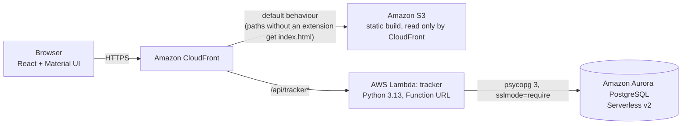
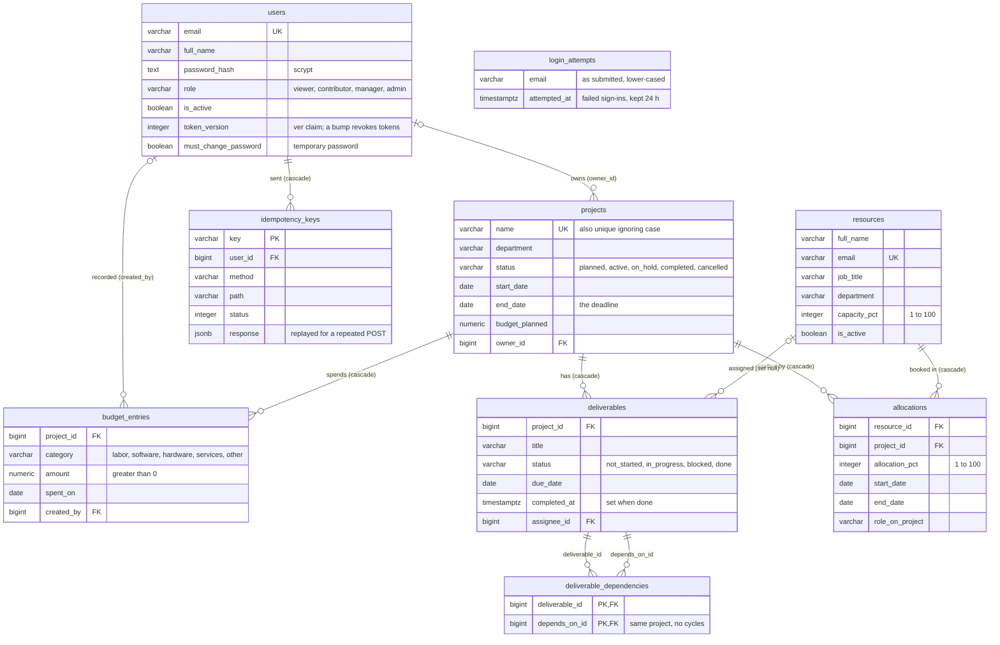

# ACME Project Tracker

A stand-alone web app that gives ACME Inc. one place to see project status, deadline risk, resource allocation, deliverables, dependencies and budget. It is a React and Material UI single-page app, served by CloudFront, with one Python Lambda and Aurora PostgreSQL behind it. It was built in one day for the Citi coding workshop.

- [API.md](API.md): every endpoint, field rule and status code
- [TESTING.md](TESTING.md): test commands, latest results with coverage, the manual end-to-end checklist
- [docs/](docs/README.md): the original workshop guide and rubric

## What it answers

The Dashboard (`#/`) answers seven questions, one section each. The other screens hold the records behind the answers.

| Business question | Screen | Endpoint |
| --- | --- | --- |
| What is the status of each active project? | Dashboard section, with a toggle for planned, on-hold or all open projects and a forecast finish ("+N days" against the deadline); Projects list | `GET /insights/project-status?status=`<br>`GET /projects` |
| Which projects are at risk? | Dashboard section, with reasons and a forecast finish date | `GET /insights/at-risk` |
| Who is allocated to which project? | Dashboard person-by-project matrix; project → Team tab | `GET /insights/allocation?on=`<br>`GET /allocations?project_id=` |
| How are deliverables progressing? | Dashboard section; project → Deliverables tab | `GET /insights/deliverables`<br>`GET /deliverables?project_id=` |
| Who is over-allocated? | Dashboard section, with the overlapping dates and projects | `GET /insights/over-allocated?from=&to=` |
| What is holding up each deliverable? | Dashboard dependency chain per project; Dependencies dialog on a deliverable | `GET /insights/dependencies?project_id=`<br>`GET /deliverables/{id}/dependencies` |
| Are projects within budget? | Dashboard section; project → Budget tab | `GET /insights/budget`<br>`GET /budgets/summary?project_id=` |

The headline tiles come from `GET /insights/summary`. All paths are under `/api/tracker`. The rules behind "at risk", "over-allocated" and the rest are defined in [API.md](API.md#insights).

The Dashboard shows when its data last arrived ("Updated 14:05"), has a Refresh button, and reloads itself every 60 seconds while its tab is visible.

## Features

- **Records.** Projects, deliverables with dependencies, people, allocations and budget entries: create, edit and delete as the role allows, with field validation in the form and again in the API.
- **Lists.** Every list has search and filters, sortable columns (a Sort select on phones) and pagination. Filters, sort, page and page size live in the URL, so a reload, a shared link and the back button restore the view.
- **Accounts.** Admins create users, change roles (after a confirmation that says what the new role can do), deactivate, reset a password to a temporary one, unlock an account that sign-in throttling locked, and delete an account that owns nothing. Everyone can change their own password from the account menu.
- **Sessions that end when they should.** The API re-reads the user on every request. Signing out, a password change, a role change and a deactivation revoke every token of that user, so an old session never carries on under a new role: when an admin changes a manager to Viewer, the manager's next request ends their session, the sign-in page says "Your session ended. Sign in again.", and once they sign in again they get the viewer interface, without write controls. A user with a temporary password can do nothing but change it.
- **Writes that happen once, and do not overwrite each other.** Forms cannot be submitted twice; a retried create carries the same idempotency key and creates one record; an edit sends only what changed and is refused if someone else changed the record first, with a Reload that refills the form.
- **One clock.** "Overdue" is decided by the API with the database's date (UTC) on every screen, and shown with its "as of" date.
- **Awkward input.** Long unbroken names wrap instead of widening the page; control characters, dates outside 2000 to 2100, oversized or deeply nested bodies are refused with a clear error; project names and departments ignore case.
- **Any device.** Tables on desktop, cards on phones, full-screen dialogs on phones, keyboard focus rings and labelled controls throughout.

## Roles and demo logins

Each user has one global role. The API checks it on every request; the UI also hides the controls a role cannot use.

| Role | Who at ACME | Can | Demo login |
| --- | --- | --- | --- |
| viewer | Stakeholder | read everything | `viewer@acme.test` |
| contributor | Team lead | read, create, update | `lead@acme.test` |
| manager | Project manager | read, create, update, delete | `manager@acme.test` |
| admin | PMO admin | all of that, plus manage users and roles | `admin@acme.test` |

All four share one password, which reaches the Lambda as `SEED_PASSWORD`:

- **Locally** (LocalStack) it is `AcmeDemo-2026`.
- **In AWS** it is never in this repository. Terraform generates a random one, unless you choose it yourself with `export TF_VAR_demo_password='...'` before `./bin/deploy-backend.sh`. Read the current one with:

  ```sh
  terraform -chdir=infra output -raw demo_password
  ```

The demo accounts follow `SEED_PASSWORD`: after it changes, the next cold start re-hashes any demo account that is on another password and signs it out. `./bin/smoke-test.sh` and `./bin/warm-up.sh` read `$SEED_PASSWORD` and fall back to the local value only for a `localhost` URL.

## Architecture



- **The edge.** CloudFront adds the AWS managed security headers policy (HSTS, `nosniff`, frame options, referrer policy) to the app and the API, and compresses the static files. A CloudFront Function on the default behaviour serves `index.html` for any path without a file extension, so `/projects/5` opens the app, which turns it into `/#/projects/5`; set `enable_spa_rewrite = false` if the role cannot create CloudFront Functions. The production build carries a Content-Security-Policy meta tag ([frontend/csp.js](frontend/csp.js)): scripts, styles, images, fonts and API calls from its own origin only.

- **One origin.** The app and the API share the CloudFront domain: the build gets the CloudFront URL as `VITE_API_URL`.
- **One Lambda.** [backend/tracker/function.py](backend/tracker/function.py) hands every request to [acme/core/http.py](backend/tracker/acme/core/http.py), which handles each request in this order:
  1. parse the event (a body over 256 KB is refused here);
  2. route it;
  3. verify the token, then re-read the user: the role, the active flag and revocation come from the database;
  4. hold a user with a temporary password to the routes that change it, then check the role;
  5. run the domain handler in one database transaction (a POST with an `Idempotency-Key` runs at most once);
  6. return the error envelope on failure;
  7. log one line.
- **Domains.** The domains are modules under [acme/domains/](backend/tracker/acme/domains/): auth, projects, deliverables, resources, allocations, budgets and insights. Most CRUD is declared as a `Resource` and served by [acme/core/crud.py](backend/tracker/acme/core/crud.py).
- **Locally**, `start-dev.sh` runs the same Lambda in LocalStack against a local PostgreSQL. Vite serves the app on `:3000`, and a proxy on `:3001` forwards `/api/tracker/*` to the Function URL.

## Data model

Every table also has `id` (identity), `created_at` and `updated_at`, except the two operational tables `login_attempts` and `idempotency_keys`, whose rows live for 24 hours. Money is `numeric(14,2)`. The schema is [acme/schema.sql](backend/tracker/acme/schema.sql); changes to it are additive and idempotent, because the deployed database keeps its data.



## Run it locally

You need Ubuntu 22.04 with the workshop tools, plus `python3.13`: `start-dev.sh` installs the Lambda's dependencies with it.

```sh
./bin/setup-environment.sh   # once per machine: Docker, LocalStack, Terraform, PostgreSQL, Node.js, AWS CLI
./bin/start-dev.sh           # PostgreSQL, LocalStack with the tracker Lambda, proxy on :3001, Vite on :3000
```

Open http://localhost:3000 and sign in with a demo login. The first API request creates the schema and seeds the demo data.

- **Code changes.** LocalStack mounts `backend/tracker`, so Python changes apply on the next request. Vite hot-reloads the frontend.
- **Infrastructure changes.** After changing anything under `infra/`, run `./bin/deploy-backend.sh local`. `start-dev.sh` does not redeploy while the number of services is unchanged.

## Deploy to AWS

```sh
export EVENT_ID=<event-id> PARTICIPANT_ID=<participant-id> PARTICIPANT_CODE=<code>   # from the organisers
./bin/deploy-backend.sh      # Terraform: networking, Aurora, the Lambda and its Function URL, S3, CloudFront
./bin/deploy-frontend.sh     # builds against the CloudFront URL, uploads to S3, invalidates the cache, prints the URL
export SEED_PASSWORD="$(terraform -chdir=infra output -raw demo_password)"   # the scripts below sign in
./bin/warm-up.sh https://<distribution>.cloudfront.net     # waits for Aurora to resume, prints timings
./bin/smoke-test.sh https://<distribution>.cloudfront.net  # health, sign-in per role, lists, 401, 403, 404, insights, and the edge
```

Both deploy scripts run `./bin/setup-participant.sh` first; see [bin/README.md](bin/README.md). Deploy the backend before or together with the frontend, because the frontend calls the backend's current endpoints.

- **The schema migrates itself.** The first request after a backend deploy applies `schema.sql` over the existing database (additive, idempotent) and brings the demo accounts onto the current `SEED_PASSWORD`. Everyone signed in before the deploy signs in once more: tokens issued by the earlier release carry no version and are refused.
- **Uploads set caching per file** ([bin/upload-frontend.sh](bin/upload-frontend.sh)): the hashed files under `assets/` are immutable for a year, `index.html` and the other root files are revalidated on every request, and files the build no longer has are deleted.
- **For an `https://` URL the smoke test also checks the edge:** the security headers, that the main script is served compressed, and that `/projects` returns the app's HTML. With `enable_spa_rewrite = false`, run it with `SPA_REWRITE=0`.

## Run the tests

```sh
./bin/test-backend.sh                     # ruff, bandit, pytest with coverage; needs PostgreSQL on localhost:5432
npm test --prefix frontend                # Vitest with React Testing Library
npm run test:coverage --prefix frontend   # the same with coverage; fails below 70% of lines
npm run lint --prefix frontend
npm run build --prefix frontend
```

Latest results: 1003 backend tests (99.5% coverage) and 458 frontend tests (98.7% of lines). [TESTING.md](TESTING.md) has the coverage tables and the manual checklists.

GitHub Actions runs all of it on every push and pull request ([.github/workflows/tests.yml](.github/workflows/tests.yml)): the backend against a PostgreSQL 16 service on Python 3.10 and 3.13, and the frontend with `npm ci` from the committed lockfile, then lint, tests with coverage and the build.

## Design decisions and trade-offs

| Decision | Why | Trade-off |
| --- | --- | --- |
| One Lambda with domain modules, not one per domain | Each extra Lambda adds a CloudFront behaviour and a slow deploy. One container also reuses one database connection and one schema check for every domain. | One deploy unit: a bad change in one domain ships with all of them. The modules can still be split later. |
| No web framework, no ORM | The required stack rules out FastAPI, Flask and ORMs. A small router and pipeline (`http.py`) and a declarative `Resource` for CRUD (`crud.py`) cover it. Dynamic SQL is built only with `psycopg.sql` and whitelisted identifiers. | We own the routing, validation and error-mapping code, so it carries its own tests (`test_http.py`, `test_validation.py`, `test_hardening.py`). |
| `HashRouter`, plus a rewrite for plain paths | We removed CloudFront's 404 → `index.html` rewrite (see findings), because it also turned API 404s into pages. Hash URLs never reach the server. A CloudFront Function now serves `index.html` for paths without a file extension, on the default behaviour only, and the app moves such a path into the hash. | URLs look like `/#/projects/3`; a typed `/projects/3` is redirected to it. The function is one more resource, behind `enable_spa_rewrite`. |
| Schema applied on cold start | `schema.sql` is idempotent. A cold start compares a checksum (the file, plus a SHA-256 of `SEED_PASSWORD`) with the one stored in `schema_meta` and applies it under `pg_advisory_xact_lock` only when they differ. This needs no migration tool and no extra deploy step, it seeds an empty database, and a rotated demo password takes effect by itself. | Changes must be additive and idempotent (`IF NOT EXISTS`), appended to the file; a test applies it over the previous release's schema, twice. There are no down migrations, and the first request after a change pays for it. |
| "Overdue" decided by the database | Lists, detail pages and the Dashboard used to disagree near midnight, because the browser compared dates with its own clock. Now every response carries `is_overdue` and `as_of` from the database's `CURRENT_DATE`, and every connection is set to UTC. | "Today" is the UTC date, which is not the viewer's date for part of each day; the UI shows "as of <date> (UTC)". |
| JWTs checked against the user row on every request | HS256 access tokens last 30 minutes and refresh tokens 7 days. Every authenticated request re-reads the user by primary key: the role and the active flag come from the row, so a change to either takes effect on the next request. For a role change made through the API, that effect is the end of the session (next row): the user signs in again and gets the new role. | One extra indexed query per request. The token's own role claim is only informational. |
| Revocation by a version on the user, not a token table | `users.token_version` is the claim `ver` in both tokens; a token whose `ver` is not the row's is refused (`token_revoked`). It is bumped by sign-out, a password change or reset, a role change and a deactivation. This needs no session table and no clean-up job, and rides on the query above. | It is all or nothing per user: signing out on one device signs out all of them. Refresh tokens are not single-use (see Known gaps). |
| Idempotency keys for POST | A double click, a retry after a timeout or a lost response must not create two records. The key is claimed with `INSERT ... ON CONFLICT DO NOTHING` at the start of the request's transaction, and the response is stored in that same transaction; a repeat replays it, and a concurrent duplicate waits on the row and then replays. A failed request rolls its claim back. | One more table, a write per keyed POST, and keys kept for 24 hours. The stored response is replayed even if the repeat's body differs, as the header promises. Responses with tokens are never stored, so the session routes ignore the header. |
| Optimistic concurrency with `expected_updated_at` | Two people editing one record must not silently overwrite each other. PUT compares the `updated_at` the client read with the row, under the `FOR UPDATE` lock the update takes anyway, and answers 409 `stale_record`. It lives in the shared CRUD helper, so every resource has it; the UI sends only changed fields and offers Reload. | A client that omits the field is not checked (the API stays usable from scripts). The comparison is per record, not per field: two people changing different fields still conflict. |
| Sign-in throttling per email, in the database | Five failures for an email in 15 minutes lock that email, whether or not the account exists, so the answer reveals nothing. The failure is recorded even though the request answers 401: the handler returns the error instead of raising, which would roll the row back. Rows are deleted on success and after 24 hours. | It is per email, not per IP: it stops guessing one account, not one password tried on many, and it lets someone lock a known email for up to 15 minutes (an admin can unlock). No new service (no Redis, no WAF). |
| Tokens in `sessionStorage` | The API takes a Bearer header and sets no cookies. `sessionStorage` is not sent automatically, so there is no CSRF, and it ends with the tab. | Any script on the page could read it (XSS). An httpOnly cookie would need backend and CloudFront changes. |
| One global role per user | Decided up front: viewer < contributor < manager < admin, checked per HTTP method (GET viewer, POST and PUT contributor, DELETE manager, `/auth/users` admin). | No per-project permissions: a contributor can edit any project. |
| scrypt from the standard library | `hashlib.scrypt` (N=2¹⁴, r=8, p=1) needs no native package beyond psycopg and PyJWT. The stored hash records its parameters, so the cost can change later. | About 16 MiB per hash, so the Lambda has 512 MB. Argon2id is the current first choice where a dependency is acceptable. |
| Vitest rather than Jest | The app is built with Vite. Vitest reuses its config and its ESM and JSX handling, and keeps Jest's API (`describe`, `it`, `expect`) for React Testing Library. | The workshop's testing section names Jest. |

## Findings in the provided scaffold

| Finding | How it was handled |
| --- | --- |
| The path differs between the local proxy and CloudFront: the proxy strips `/api/tracker`, while CloudFront passes it to the Function URL. | The router accepts both (`strip_prefix`). Every API test runs once with each path style. |
| The dev proxy dropped the `Authorization` header: it forwarded only a fixed list of headers. | `bin/proxy-server.js` now forwards `authorization` (one line). |
| CloudFront's `custom_error_response` turned API 404s into 200 responses with `index.html`. | Removed in `infra/cloudfront.tf`, and never to be re-added. The app uses `HashRouter`; deep links are handled by a CloudFront Function on the default behaviour only, so the API's errors stay untouched. `smoke-test.sh` checks that an unknown id is a JSON 404 and that `/projects` returns the app. |
| Aurora can pause: `min_capacity = 0` in `infra/rds.tf`, so the first connection after idle fails or times out. | `connect_timeout` is 15 s, and a request reconnects and retries once on `OperationalError` (`db.run_with_retry`). The UI shows errors with Retry, and `bin/warm-up.sh` wakes the database before a demo. |
| Function URLs are public (`authorization_type = "NONE"`) and can be called without CloudFront. | The service enforces auth itself. Every route except `/health`, `/auth/login` and `/auth/refresh` needs a valid access token and role, and `test_hardening.py` checks this against the whole route table. Left as designed; see Known gaps. |
| The demo password was a default in `infra/variable.tf`, and so in the repository and in every deployment. | The variable now defaults to null. In AWS Terraform generates a random password (`terraform output -raw demo_password`) unless `TF_VAR_demo_password` sets one; only LocalStack keeps a fixed value. The demo accounts follow it, and the sign-in page lists the demo emails in development builds only. |
| The repository ignored `package-lock.json`, so CI and every deploy resolved the `^` ranges afresh. | `frontend/package-lock.json` is committed and CI installs with `npm ci`. |
| No JWT secret was provided. | Terraform generates `random_password.jwt` and passes it as `JWT_SECRET`. The env-var filter in `infra/lambda.tf` uses `nonsensitive()` in its condition only: the secret stays sensitive, but the map keys do not. A cold start without `JWT_SECRET` fails with a clear message. |
| `start-dev.sh` pip-installs dependencies into the service folder (`backend/tracker/`), and ignored install failures. | `.gitignore` tracks only `function.py`, `requirements.txt` and `acme/` there. `test-backend.sh` excludes git-ignored paths from bandit. Tests append the folder to `sys.path`, so the venv's packages win. The tracker's install uses `python3.13`, checks that psycopg's binary build loads, and fails loudly. |
| Two ESLint plugins were missing: `eslint.config.js` imported `eslint-plugin-react-hooks` and `eslint-plugin-react-refresh`, but `package.json` did not list them, so `npm run lint` could not run. | Added both as dev dependencies. |
| `start-dev.sh` does not redeploy when the service count is unchanged. It only compares the number of services on disk with the number deployed, and checks that one Function URL answers. | Documented under [Run it locally](#run-it-locally): after infrastructure changes, run `./bin/deploy-backend.sh local`. Code changes reach LocalStack through hot reload. |

## Known gaps

Documented, not changed:

- **The Lambda Function URL has no authentication of its own** (`authorization_type = "NONE"`) and can be called directly, without CloudFront. That is the workshop scaffold's design. The service authenticates every request itself (a valid token and role on every route but `/health`, `/auth/login` and `/auth/refresh`), so going around CloudFront only skips the edge's security headers and compression.
- **The Function URL's CORS allows any origin.** Tokens are sent in a header by our own code, never in a cookie the browser attaches by itself, so another site cannot ride on a signed-in user's session. Restricting the origin to the CloudFront domain would make the Lambda depend on the distribution, which already depends on the Lambda: a Terraform cycle.
- **The app connects to the database as the master user**, whose password is a `random_pet` (three dictionary words) kept in Terraform state and in the Lambda's environment. The fix is a least-privilege database role for the app and its password in Secrets Manager, with rotation.
- **Sign-in throttling is per email, not per IP.** It stops guessing one account's password. It does not stop one address trying one password against many accounts, and it lets anyone lock a known email out for up to 15 minutes (an admin can unlock it). Per-IP limits belong at the edge (AWS WAF), which the workshop role does not provide.
- **Refresh tokens can be revoked but are not single-use.** Signing out, a password change, a role change and a deactivation end every session at once (`token_version`). A stolen refresh token still works until one of those happens or it expires after 7 days; rotating it on every use, with reuse detection, would need a table of issued tokens.
- **Per-project permissions.** Roles are global: anyone with contributor rights can edit every project.
- **API responses are not compressed.** `compress = true` is set on every CloudFront behaviour, but CloudFront only compresses what it may cache, and the API behaviours use the no-caching policy. The static files are compressed; API responses are small JSON.
- **Audit log.** The app records `created_by` on budget entries and `updated_at` everywhere, but not who changed what.
- **Automated end-to-end and load tests.** The end-to-end checklist in [TESTING.md](TESTING.md#manual-end-to-end-checklist) is manual. There are no Cypress, Selenium, Artillery or JMeter runs.

## Repository layout

| Path | Contents |
| --- | --- |
| `backend/tracker/` | The Lambda: `function.py`, `requirements.txt` and the `acme/` package (`core/`, `domains/`, `schema.sql`, `seed.py`) |
| `frontend/src/` | `pages/`, `components/`, `hooks/`, `context/`, `services/` (API client and session), `utils/`, tests next to the code |
| `frontend/csp.js` | The Content-Security-Policy and the Vite plugin that injects it into production builds |
| `tests/backend/` | pytest integration tests against PostgreSQL, plus checks of the scripts and the Terraform files |
| `infra/` | Terraform: networking, Aurora, Lambda, S3, CloudFront, and `spa-rewrite.js` (the CloudFront Function) |
| `bin/` | Workshop scripts, plus `test-backend.sh`, `smoke-test.sh`, `warm-up.sh` and `upload-frontend.sh` |
| `.github/workflows/tests.yml` | CI: backend and frontend checks on every push and pull request |

Licensed as described in [LICENSE](LICENSE).
