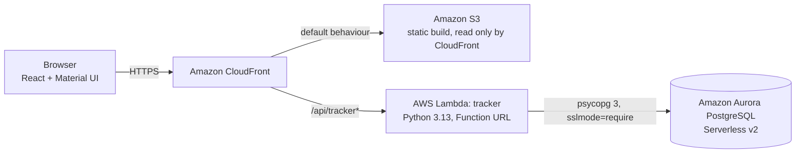
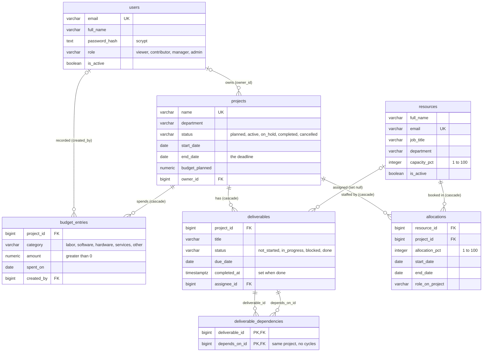

# ACME Project Tracker

A stand-alone web app that gives ACME Inc. one place to see project status, deadline risk, resource allocation, deliverables, dependencies and budget. It is a React and Material UI single-page app, served by CloudFront, with one Python Lambda and Aurora PostgreSQL behind it. It was built in one day for the Citi coding workshop.

- [API.md](API.md): every endpoint, field rule and status code
- [TESTING.md](TESTING.md): test commands, latest results with coverage, the manual end-to-end checklist
- [docs/](docs/README.md): the original workshop guide and rubric

## What it answers

The Dashboard (`#/`) answers seven questions, one section each. The other screens hold the records behind the answers.

| Business question | Screen | Endpoint |
| --- | --- | --- |
| Where does each project stand? | Dashboard section; Projects list | `GET /insights/project-status`<br>`GET /projects` |
| Which projects are at risk? | Dashboard section, with reasons and a forecast finish date | `GET /insights/at-risk` |
| Who is allocated to which project? | Dashboard person-by-project matrix; project → Team tab | `GET /insights/allocation?on=`<br>`GET /allocations?project_id=` |
| How are deliverables progressing? | Dashboard section; project → Deliverables tab | `GET /insights/deliverables`<br>`GET /deliverables?project_id=` |
| Who is over-allocated? | Dashboard section, with the overlapping dates and projects | `GET /insights/over-allocated?from=&to=` |
| What is holding up each deliverable? | Dashboard dependency chain per project; Dependencies dialog on a deliverable | `GET /insights/dependencies?project_id=`<br>`GET /deliverables/{id}/dependencies` |
| Are projects within budget? | Dashboard section; project → Budget tab | `GET /insights/budget`<br>`GET /budgets/summary?project_id=` |

The headline tiles come from `GET /insights/summary`. All paths are under `/api/tracker`. The rules behind "at risk", "over-allocated" and the rest are defined in [API.md](API.md#insights).

## Roles and demo logins

Each user has one global role. The API checks it on every request; the UI also hides the controls a role cannot use.

| Role | Who at ACME | Can | Demo login |
| --- | --- | --- | --- |
| viewer | Stakeholder | read everything | `viewer@acme.test` |
| contributor | Team lead | read, create, update | `lead@acme.test` |
| manager | Project manager | read, create, update, delete | `manager@acme.test` |
| admin | PMO admin | all of that, plus manage users and roles | `admin@acme.test` |

All four use the password `AcmeDemo-2026`. That is the default of the Terraform variable `demo_password` in [infra/variable.tf](infra/variable.tf), which reaches the Lambda as `SEED_PASSWORD`.

To use another password, run `export TF_VAR_demo_password='...'` before the first `./bin/deploy-backend.sh`, or change the default. The seed creates the demo users only while the `users` table is empty, so a later change does not touch existing accounts. After that, an admin sets a new password with `PUT /api/tracker/auth/users/{id}` and `{"password": "..."}`. The Users screen changes roles and activation, not passwords.

## Architecture



- **One origin.** The app and the API share the CloudFront domain: the build gets the CloudFront URL as `VITE_API_URL`.
- **One Lambda.** [backend/tracker/function.py](backend/tracker/function.py) hands every request to [acme/core/http.py](backend/tracker/acme/core/http.py), which handles each request in this order:
  1. parse the event;
  2. route it;
  3. authenticate the token;
  4. check the role;
  5. run the domain handler in one database transaction;
  6. return the error envelope on failure;
  7. log one line.
- **Domains.** The domains are modules under [acme/domains/](backend/tracker/acme/domains/): auth, projects, deliverables, resources, allocations, budgets and insights. Most CRUD is declared as a `Resource` and served by [acme/core/crud.py](backend/tracker/acme/core/crud.py).
- **Locally**, `start-dev.sh` runs the same Lambda in LocalStack against a local PostgreSQL. Vite serves the app on `:3000`, and a proxy on `:3001` forwards `/api/tracker/*` to the Function URL.

## Data model

Every table also has `id` (identity), `created_at` and `updated_at`. Money is `numeric(14,2)`. The schema is [acme/schema.sql](backend/tracker/acme/schema.sql).



## Run it locally

You need Ubuntu 22.04 with the workshop tools, plus `python3.13`: `start-dev.sh` installs the Lambda's dependencies with it.

```sh
./bin/setup-environment.sh   # once per machine: Docker, LocalStack, Terraform, PostgreSQL, Node.js, AWS CLI
./bin/start-dev.sh           # PostgreSQL, LocalStack with the tracker Lambda, proxy on :3001, Vite on :3000
```

Open http://localhost:3000 and sign in with a demo login. The first API request creates the schema and seeds the demo data.

- **Code changes.** LocalStack mounts `backend/tracker`, so Python changes apply on the next request. Vite hot-reloads the frontend.
- **Infrastructure changes.** After changing anything under `infra/`, run `./bin/deploy-backend.sh local`. `start-dev.sh` does not redeploy while the number of services is unchanged.

## Deploy to AWS

```sh
export EVENT_ID=<event-id> PARTICIPANT_ID=<participant-id> PARTICIPANT_CODE=<code>   # from the organisers
./bin/deploy-backend.sh      # Terraform: networking, Aurora, the Lambda and its Function URL, S3, CloudFront
./bin/deploy-frontend.sh     # builds against the CloudFront URL, uploads to S3, invalidates the cache, prints the URL
./bin/warm-up.sh https://<distribution>.cloudfront.net     # waits for Aurora to resume, prints timings
./bin/smoke-test.sh https://<distribution>.cloudfront.net  # health, sign-in per role, lists, 401, 403, 404, insights
```

Both deploy scripts run `./bin/setup-participant.sh` first; see [bin/README.md](bin/README.md). Deploy the backend before or together with the frontend, because the frontend calls the backend's current endpoints.

## Run the tests

```sh
./bin/test-backend.sh                     # ruff, bandit, pytest with coverage; needs PostgreSQL on localhost:5432
npm test --prefix frontend                # Vitest with React Testing Library
npm run test:coverage --prefix frontend   # the same with coverage; fails below 70% of lines
npm run lint --prefix frontend
npm run build --prefix frontend
```

Latest results: 492 backend tests (99.7% of lines) and 224 frontend tests (97.8% of lines). [TESTING.md](TESTING.md) has the coverage tables and the manual checklist.

## Design decisions and trade-offs

| Decision | Why | Trade-off |
| --- | --- | --- |
| One Lambda with domain modules, not one per domain | Each extra Lambda adds a CloudFront behaviour and a slow deploy. One container also reuses one database connection and one schema check for every domain. | One deploy unit: a bad change in one domain ships with all of them. The modules can still be split later. |
| No web framework, no ORM | The required stack rules out FastAPI, Flask and ORMs. A small router and pipeline (`http.py`) and a declarative `Resource` for CRUD (`crud.py`) cover it. Dynamic SQL is built only with `psycopg.sql` and whitelisted identifiers. | We own the routing, validation and error-mapping code, so it carries its own tests (`test_http.py`, `test_validation.py`, `test_hardening.py`). |
| `HashRouter` | We removed CloudFront's 404 → `index.html` rewrite (see findings), so the server can no longer fall back to the SPA for deep links. Hash URLs never reach the server. | URLs look like `/#/projects/3`. |
| Schema applied on cold start | `schema.sql` is idempotent. A cold start compares its SHA-256 with the one stored in `schema_meta` and applies it under `pg_advisory_xact_lock` only when they differ. This needs no migration tool and no extra deploy step, and it also seeds an empty database. | Changes must be written idempotently (`IF NOT EXISTS`). There are no down migrations, and the first request after a schema change pays for it. |
| Stateless JWT with refresh, no revocation | HS256 access tokens last 30 minutes and refresh tokens 7 days. A refresh re-reads the user, so role changes and deactivation apply at the next refresh. No session table and no extra query per request. | A deactivated or demoted user keeps their old rights until the access token expires, up to 30 minutes. Signing out only forgets the tokens in the browser. |
| Tokens in `sessionStorage` | The API takes a Bearer header and sets no cookies. `sessionStorage` is not sent automatically, so there is no CSRF, and it ends with the tab. | Any script on the page could read it (XSS). An httpOnly cookie would need backend and CloudFront changes. |
| One global role per user | Decided up front: viewer < contributor < manager < admin, checked per HTTP method (GET viewer, POST and PUT contributor, DELETE manager, `/auth/users` admin). | No per-project permissions: a contributor can edit any project. |
| scrypt from the standard library | `hashlib.scrypt` (N=2¹⁴, r=8, p=1) needs no native package beyond psycopg and PyJWT. The stored hash records its parameters, so the cost can change later. | About 16 MiB per hash, so the Lambda has 512 MB. Argon2id is the current first choice where a dependency is acceptable. |
| Vitest rather than Jest | The app is built with Vite. Vitest reuses its config and its ESM and JSX handling, and keeps Jest's API (`describe`, `it`, `expect`) for React Testing Library. | The workshop's testing section names Jest. |

## Findings in the provided scaffold

| Finding | How it was handled |
| --- | --- |
| The path differs between the local proxy and CloudFront: the proxy strips `/api/tracker`, while CloudFront passes it to the Function URL. | The router accepts both (`strip_prefix`). Every API test runs once with each path style. |
| The dev proxy dropped the `Authorization` header: it forwarded only a fixed list of headers. | `bin/proxy-server.js` now forwards `authorization` (one line). |
| CloudFront's `custom_error_response` turned API 404s into 200 responses with `index.html`. | Removed in `infra/cloudfront.tf`. The app uses `HashRouter` instead, and `smoke-test.sh` checks that an unknown id is a JSON 404. |
| Aurora can pause: `min_capacity = 0` in `infra/rds.tf`, so the first connection after idle fails or times out. | `connect_timeout` is 15 s, and a request reconnects and retries once on `OperationalError` (`db.run_with_retry`). The UI shows errors with Retry, and `bin/warm-up.sh` wakes the database before a demo. |
| Function URLs are public (`authorization_type = "NONE"`) and can be called without CloudFront. | The service enforces auth itself. Every route except `/health`, `/auth/login` and `/auth/refresh` needs a valid access token and role, and `test_hardening.py` checks this against the whole route table. |
| No JWT secret was provided. | Terraform generates `random_password.jwt` and passes it as `JWT_SECRET`. The env-var filter in `infra/lambda.tf` uses `nonsensitive()` in its condition only: the secret stays sensitive, but the map keys do not. A cold start without `JWT_SECRET` fails with a clear message. |
| `start-dev.sh` pip-installs dependencies into the service folder (`backend/tracker/`), and ignored install failures. | `.gitignore` tracks only `function.py`, `requirements.txt` and `acme/` there. `test-backend.sh` excludes git-ignored paths from bandit. Tests append the folder to `sys.path`, so the venv's packages win. The tracker's install uses `python3.13`, checks that psycopg's binary build loads, and fails loudly. |
| Two ESLint plugins were missing: `eslint.config.js` imported `eslint-plugin-react-hooks` and `eslint-plugin-react-refresh`, but `package.json` did not list them, so `npm run lint` could not run. | Added both as dev dependencies. |
| `start-dev.sh` does not redeploy when the service count is unchanged. It only compares the number of services on disk with the number deployed, and checks that one Function URL answers. | Documented under [Run it locally](#run-it-locally): after infrastructure changes, run `./bin/deploy-backend.sh local`. Code changes reach LocalStack through hot reload. |

## Known gaps

- **Per-project permissions.** Roles are global: anyone with contributor rights can edit every project.
- **Token revocation.** There is no server-side sign-out or deny list. A deactivated user keeps access until their access token expires (up to 30 minutes).
- **Audit log.** The app records `created_by` on budget entries and `updated_at` everywhere, but not who changed what.
- **Automated end-to-end and load tests.** The end-to-end checklist in [TESTING.md](TESTING.md#manual-end-to-end-checklist) is manual. There are no Cypress, Selenium, Artillery or JMeter runs.
- **CI running the tests.** The GitHub workflows run bandit, `npm audit` and Terraform checks, but not pytest, Vitest, ESLint or the build.

## Repository layout

| Path | Contents |
| --- | --- |
| `backend/tracker/` | The Lambda: `function.py`, `requirements.txt` and the `acme/` package (`core/`, `domains/`, `schema.sql`, `seed.py`) |
| `frontend/src/` | `pages/`, `components/`, `hooks/`, `context/`, `services/` (API client and session), `utils/`, tests next to the code |
| `tests/backend/` | pytest integration tests against PostgreSQL |
| `infra/` | Terraform: networking, Aurora, Lambda, S3, CloudFront |
| `bin/` | Workshop scripts, plus `test-backend.sh`, `smoke-test.sh` and `warm-up.sh` |

Licensed as described in [LICENSE](LICENSE).
